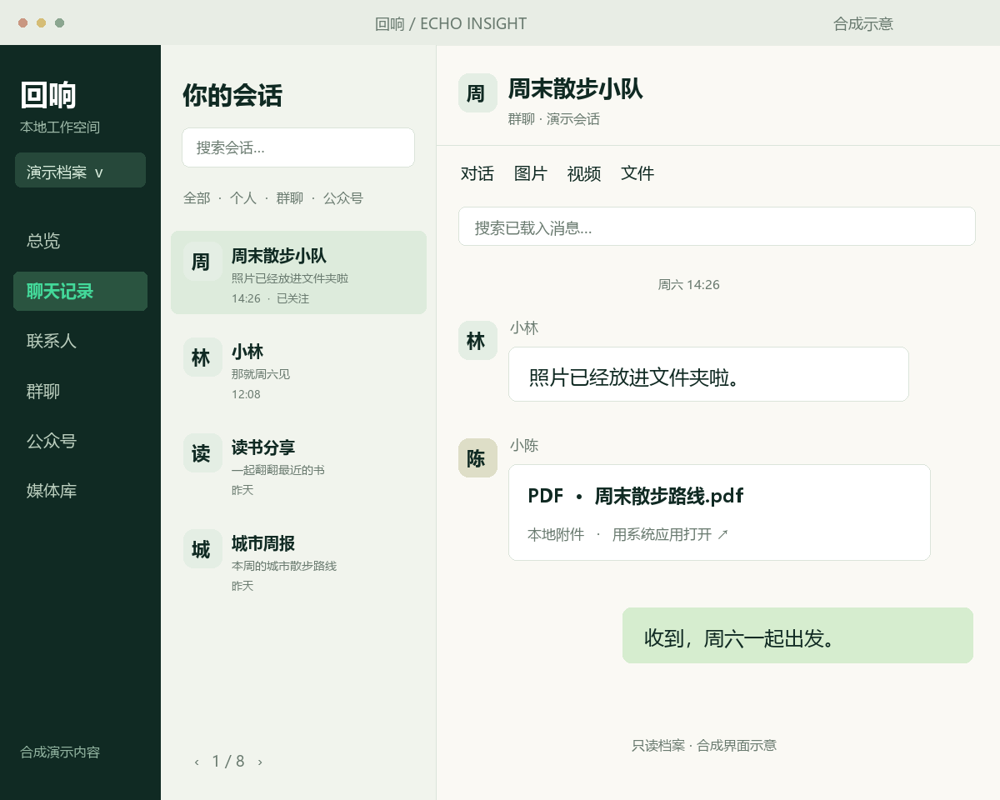

# 回响 / Echo Insight

**面向散户投资者，把投资群与关注公众号里的线索整理成可回查的研究材料。**

[官网](https://huixiang.nickszy.com) · [功能与范围](https://huixiang.nickszy.com/features.html) · [最新 ZIP 下载](https://github.com/Nickszy/huixiang/releases/latest) · [介绍视频](website/assets/echo-insight-intro.mp4) · [反馈](https://github.com/Nickszy/huixiang/issues)

加入了自己认可的投资群、关注了研究公众号，却常常找不到讨论过的标的、图表和研报？回响希望成为散户投资者的本机研究工作台：关注信息来源，回查观点，找到资料，再核对依据。这些内容是待核实的研究线索，不是买卖结论。

## 先确认版本

| 范围 | 状态 |
| --- | --- |
| Windows 本机档案、聊天浏览与媒体库 | 已发布 2026-10-12 免安装技术预览 ZIP |
| 历史 Windows 0.1.0 演示包 | 保留在历史 Release；新用户请下载最新 ZIP |
| macOS 安装包与采集 | 尚未发布 |
| AI 助手、自然语言自动化任务、推送渠道与 HTTP/MCP | 本版已接入，使用前需配置模型、数据源与渠道 |

图片和视频均为**合成界面示意**，不含真实人物或聊天，也不是已发布安装包的录屏。

## 从群聊线索到投资研究

- **关注认可的投资群**：个人、群聊、公众号分类；关注自己选择的群，最近消息优先，支持分页、会话搜索与关注筛选。产品不自动评判群的质量。
- **回看关注的公众号**：在公众号分类中添加关注、筛选关注账号，按最近消息回查本机已有的文章分享与讨论；原消息含有效网页链接时可打开。当前不抓取公众号全部历史文章，也不自动读取文章正文。
- **回查标的讨论**：用标的名称搜索当前已载入的消息，核对原话、讨论时间和不同观点；更早消息滚动载入。当前没有全档案搜索或标的自动提取。
- **归档研报资料**：在会话和媒体库查找 PDF 研报、Excel 估值表、Word 纪要和音频；按文件名搜索、翻页、排序，并用系统应用打开可读取附件。
- **图片说清楚**：尝试解码微信 4.x 本机图片，优先选择原图候选；筛选原图文件存在、仅缩略图或缺失文件。是否可读取取决于本机文件、密钥与格式，部分格式需要 FFmpeg。
- **本机保存与刷新**：用户选择保存目录；应用打开时默认每 5 分钟检查变化，只重新处理变化的整库并替换结果，未变化库跳过。关闭应用后不检查。

数据库密钥加密保存在本机；解密后的数据库及图片缓存含明文私人内容，请保护相应目录。普通档案浏览不调用云端模型。使用 AI 时，相关指令和检索内容会发送至用户配置的模型服务，推送发往指定渠道；任务与执行记录仍包含明文内容，尚未做内容加密。完整说明见[隐私与边界](https://huixiang.nickszy.com/privacy.html)。

语音播放、表情资源、全档案全文搜索尚未接入；视频和文件的群聊/发送者关联仍需补全。文件缺失无法恢复；有原图文件也不保证可以解码。微信版本兼容性仍在验证，不承诺支持所有 4.x 版本。

## 投资场景演示与后续方向

当前开发版新增「标的研究演示群」和「研报共读演示群」：使用虚构的示例科技（DEMO-01），展示线索、假设、风险与待核实事项的本地合成摘要，以及群聊原话回查。旧演示报告保留。演示摘要由预置本地规则生成，不是云端 AI，也没有读取 PDF 正文。

新版 AI 工作台和聊天内嵌助手可按用户指令查询已解析消息、整理观点，并显示运行中的公开流式回答与工具记录。每个自动化任务是一段自然语言指令，支持指定时间、消息事件、静默窗口与语义条件触发；结果可留在工作台或发往用户配置的飞书、钉钉和 Webhook 渠道。AI 后台启动后关闭客户端窗口仍继续调度；电脑关机或后台停止时不执行。消息触发需要持续更新的解析档案或采集端提交事件，一次性导入历史不会产生新消息。

公众号文章正文抓取、附件正文自动解析与标的自动提取仍未接入。现有 5 分钟档案检查不等于公众号文章追踪。上方研究演示的人名、标的、代码与附件均为虚构，不展示真实证券观点、收益预测或买卖建议。

## 公开下载：2026-10-12 Windows 免安装版

[下载最新 Release](https://github.com/Nickszy/huixiang/releases/latest)。完整解压 ZIP，双击 `EchoInsight.exe`，保留 `resources` 文件夹；无需安装软件或 Python。

| 文件 | 大小 | SHA-256 |
| --- | --- | --- |
| [Windows x64 便携 ZIP](https://github.com/Nickszy/huixiang/releases/download/v0.1.0-20261012/echoinsight-20261012-windows-x64-portable.zip) | 31,257,802 字节 | `7b3307f3d17863f7e9719864a3dead420371fc1d6d37599e890010161a025644` |
| [校验文件](https://github.com/Nickszy/huixiang/releases/download/v0.1.0-20261012/SHA256SUMS.txt) | SHA256SUMS.txt | 用于核对 ZIP |

旧用户到 **设置 → AI 模型 → 更新后台**，任务运行中请等完成后再更新，无需重启电脑；模型配置、密钥、任务和会话历史保留。首次使用按 Windows 采集引导准备本机数据，再配置模型与推送渠道。

Windows 10 1809+ / Windows 11 x64，需要 WebView2。程序未签名，ZIP 免安装仍可能出现系统安全提示。应用构建并发布于 2026-10-12；135 项 Python 测试、前端与 Windows 原生构建通过。当前为技术预览，详细验证范围与已知限制见 Release 说明。macOS 包尚未发布，软件没有自动下载升级功能。

早期合成演示包保留在[历史 Release](https://github.com/Nickszy/huixiang/releases/tag/v0.1.0)。

## 项目与素材

公开发布仓库保存官网源码、发布信息与推广素材；桌面应用源码尚未完整公开，不能通过克隆此发布仓库直接构建桌面客户端。

- [官网维护与发布](website/README.md)
- [小红书介绍稿](promotions/xiaohongshu.md)
- [产品视频分镜](promotions/video-script.md)
- [素材生成与归档](promotions/README.md)
- [Easel 参考记录](promotions/reference-easel.md)

内容组织参考 [ZJU-REAL/Easel](https://github.com/ZJU-REAL/Easel) 的项目化创作与素材归档方式；没有使用其代码或媒体，也没有合作或背书关系。回响是独立技术预览，非微信官方产品。
